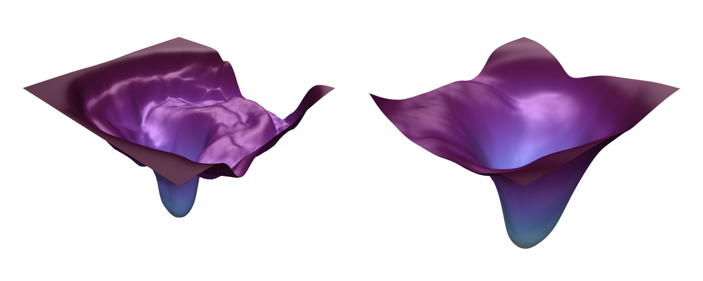

# Loss Landscapes

## Abstract

This is a short exploration into visualizing loss landscapes for neural networks. Small ResNets with and without skip connections are trained on Fashion-MNIST, and the loss around their trained weights is evaluated on a 2D slice through parameter space, spanned by two random directions. Comparing a naive (global) normalization of these directions with the filter normalization of Li et al. shows how skip connections smooth the landscape of deeper networks.

Inspiration for this project:
- [LossLandscape Website](https://losslandscape.com/)
- [Paper "Visualizing the Loss Landscape of Neural Nets"](https://arxiv.org/abs/1712.09913)

## Setup

1. Install the uv package manager: https://docs.astral.sh/uv/getting-started/installation/
2. Clone the repo
    - `git clone https://github.com/eliassteiner1/loss-landscapes.git`
    - `cd loss-landscapes`
3. Sync the environment from the lockfile: `uv sync`
    > Note: plain `uv sync` installs `torch` from PyPI (CPU build on Windows/macOS, CUDA build on Linux). To pick a build explicitly, use `uv sync --group cpu` or `uv sync --group cu134` (CUDA 13.4). uv does not remember the group, so pass the same `--group` flag again to every later `uv sync` / `uv run`, otherwise torch is switched back to the PyPI build.
    >
    > If you need a different CUDA version or PyTorch build, replace the index and source configuration for `torch` and `torchvision` in `pyproject.toml`.
4. Open the notebooks and select the project's `.venv` as the kernel.

## Usage

`01` and `02` work independently of each other. The computed ResNet landscapes are included in the repo, so `02` only plots them and doesn't need any training. `00` is only needed if you want to regenerate everything yourself, e.g. with a different grid resolution.

- `notebooks/01_demo_simple.ipynb`: the whole pipeline on a tiny MLP fitted to a synthetic 2D function: generating data, training, creating random directions (naive vs. filter normalization) and plotting the landscape.
- `notebooks/02_demo_resnet.ipynb`: the main results. Plots the precomputed landscapes of shallow and deep ResNets, with and without skip connections, for both normalization methods.
- `notebooks/00_setup.ipynb`: regenerates everything from scratch (datasets, ResNet training, landscape evaluation). Optional, and compute-heavy: a GPU is strongly recommended.
